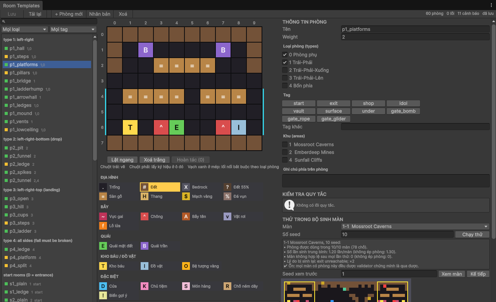

# Hướng dẫn mở rộng – Brindlemoor: The Sunstone Hunt (Gloomdelve)

Tài liệu này chỉ ra **phải đụng vào đâu** khi thêm nội dung mới. Nguyên tắc chung của code:

- **Dữ liệu nằm trong asset** (`Assets/Game/Data`), hành vi nằm trong class nhỏ đăng ký theo **id chuỗi**. Thêm thứ mới = thêm asset + (nếu cần) một class, không sửa `PlayerController`, HUD hay bộ sinh màn.
- **Mọi màn sinh ra đều được `LevelValidator` chứng minh là qua được**, nên nội dung mới sai chỉ khiến màn bị sinh lại chứ không tạo ra màn kẹt.
- Sau khi sửa: **Brindlemoor > Tests > Logic Tests** và **Seed Sweep**; nếu đổi prefab/art/scene thì chạy **Brindlemoor > Build Everything** trước. Trong bản build, chỉ chạy các kịch bản liên quan: `Brindlemoor.exe -scenarios -scenarioFilter "từ1,từ2"` (ghi `scenario_report_partial.txt`).

| Muốn thêm | Cần code? | Làm ở đâu |
|---|---|---|
| Mẫu phòng mới | Không | Tool **Brindlemoor > Room Template Editor** |
| Đặt một prefab bất kỳ vào mẫu phòng | Không | `GameConfig > Custom Markers` |
| Nâng cấp chỉ cộng chỉ số | Không | `ShopConfig > Offers` |
| Nâng cấp có hành vi riêng | Vài dòng | `ShopConfig` + `RunState.HasActive("id")` |
| Vật phẩm nhặt (pickup) mới | Không (chỉ prefab) | Prefab `Pickup` + `PrefabRegistry` |
| Đồ dùng mới (như bom/dây/tàu lượn/Recall Charm) | 1 class | `Scripts/Gear` |
| Kẻ địch / bẫy mới | 1 class | `Scripts/Enemies`, `Scripts/Traps` + `PrefabRegistry` |
| Boss mới | 1 class | `Scripts/Bosses` (kế thừa `Boss`) + đấu trường `Levels/Boss_*.txt` |
| Khu mới (trọn gói) | Có | `AreaConfig` + `GameConfig > Stages` + quái, bẫy, boss, đồ nổi bật (mục 6) |
| Phím đổi được cho hành động mới | 1 dòng | `KeyBindings.Slots` (mục 7) |

---

## 1. Mẫu phòng – tool cho Game Designer

Mở **Brindlemoor > Room Template Editor**. Tool đọc/ghi thẳng `Assets/Game/Data/RoomTemplates.txt` (file văn bản vẫn là nguồn duy nhất, sửa tay vẫn được).



**Bố cục cửa sổ**

- **Cột trái** – danh sách phòng, ô tìm theo tên, lọc theo loại và tag. Chấm màu: xanh = hợp lệ, vàng = có cảnh báo, đỏ = có lỗi.
- **Giữa** – lưới 10×8. Chuột trái vẽ ký hiệu đang chọn, chuột phải lấy ký hiệu ở ô đó. **Vạch xanh ở mép lưới** cho biết chỗ bắt buộc phải hở theo loại phòng đã tick. Bên dưới là bảng ký hiệu (rê chuột để xem giải thích), nút Lật ngang / Xoá trắng / Hoàn tác.
- **Cột phải** – tên, weight, loại phòng, tag, khu, ghi chú; kết quả **kiểm tra quy tắc** cập nhật ngay khi vẽ; phần **thử trong bộ sinh màn**.

**Quy trình làm một phòng mới**

1. `+ Phòng mới` (hoặc `Nhân bản` một phòng gần giống).
2. Tick **loại phòng**: `1` trái-phải, `2` có lối xuống, `3` có lối lên, `4` bốn phía, `0` phòng phụ ngoài đường chính. Một phòng tick được nhiều loại.
3. Vẽ. Giữ các vạch xanh hở.
4. Sửa hết lỗi đỏ trong mục *Kiểm tra quy tắc*.
5. **Chạy thử** (30 seed): tool ép phòng này vào mọi chỗ phù hợp rồi cho validator chứng minh từng màn; báo cáo cho biết phòng được dùng bao nhiêu lần, có làm bộ sinh màn phải sinh lại nhiều hơn không.
6. **Xem màn** để nhìn bản đồ thu nhỏ (khung vàng = phòng đang thử), **▶ Chơi thử màn này** để vào Play ngay trong màn đó (cùng seed với bản xem trước).
7. **Lưu**.

**Ý nghĩa ký hiệu** – xem bảng ngay trong tool (hoặc `RoomLegend.cs`). Lưu ý các ký hiệu bẫy/quái/kho báu là *vị trí có thể xuất hiện*: xác suất thật do `AreaConfig` của khu quyết định, nên cùng một phòng sẽ khác nhau giữa các khu.

**Tag đặc biệt**: `start`, `exit` (cần đúng 1 cửa `D`), `shop` (cần `K` và `S`, hở bên phải), `idol` (cần `O`), `vault`, `surface`/`under` (khu ngoài trời), `up_out`/`up_in` (đoạn leo), `gate_<id đồ>` (phòng chướng ngại bắt buộc dùng đồ đó).

### Đặt prefab mới vào phòng mà không cần code

`GameConfig.asset > Custom Markers > +`:

| Trường | Ý nghĩa |
|---|---|
| Symbol | 1 ký tự chưa dùng (ví dụ `M`) |
| Label | Tên hiện trong bảng ký hiệu của tool |
| Spawn Id | id trong `PrefabRegistry` (ví dụ `crate`, `heart`, hoặc prefab mới của bạn) |
| Chance | Xác suất xuất hiện |
| Placement | `OnFloor` (cần sàn), `UnderCeiling` (cần trần), `Anywhere` |
| Tile | Ô địa hình ghi vào chỗ đó (thường `Empty`) |

Ký hiệu mới xuất hiện ngay trong tool (đóng/mở lại cửa sổ hoặc bấm *Tải lại*), dùng được cả trong các màn làm tay `Levels/*.txt` (Tutorial, Camp, FinalVault, đấu trường boss).

---

## 2. Nâng cấp (bán trong cửa hàng)

`ShopConfig.asset > Offers > +`, tick **Is Upgrade** và chọn **Slot** (feet / body / hand / charm). Chỉ món đang mặc mới có tác dụng; món mới tự mặc nếu ô còn trống, không thì nằm trong túi (tab WEAR).

- **Chỉ cộng chỉ số** → điền `Modifiers`, không cần code:
  `jumpBonus` (0.17 = nhảy mạnh hơn 17%), `whipDamageBonus`, `whipRangeBonus`, `blastRadiusBonus`, `iceGrip`, `coldResist`, `sporeResist`, `lightBonus`, `beltGrip`, `shieldPierce`, `sandGrip`, `goldWard`, `shardWard`, `mimicSight`. Các món đang mặc cộng dồn với nhau.
- **Có hành vi riêng** → trong code hỏi `RunSession.Current.HasActive("id_cua_ban")` (đang mặc; `HasUpgrade` chỉ là đã sở hữu). Ví dụ có sẵn: Compass (`HUD.cs`), Tempered Blade (`PlayerController.cs`).
- **Cần một chỉ số mới** (ví dụ tốc độ chạy): thêm 1 trường vào `StatModifiers` và vào `Add`, `Clear`, `IsZero` (`Configs.cs`), rồi đọc `Run.stats.<trường>` ở nơi dùng.

Kệ shop trên núi có 5 món: bom, dây, một món hồi máu và 2 nâng cấp (món nổi bật của khu trong `AreaConfig.shopFeatured`, không có thì ngẫu nhiên); món đã sở hữu không được bày. HUD hiện biểu tượng đồ đang mặc, lượt mới tự xoá sạch. Muốn dân làng bán món đó: thêm id vào danh sách hàng của người đó trong `Villagers.cs`. Giá ở làng tự tính từ giá vàng (`max(1, round(giá / 250))`), trả bằng spark; món lâu dài trả bằng ember thì thêm id vào `Villagers.PaidInEmbers`.

Món tiêu hao (không tick Is Upgrade): điền `Resource` + `Amount`. Resource có sẵn: `gold`, `health`, `bombs`, `ropes`, `maxhealth`…; id khác được lưu thành bộ đếm riêng (`RunState.GetResource / AddResource`), dùng làm đạn cho đồ dùng mới.

## 3. Vật phẩm nhặt (pickup)

Prefab có component `Pickup`: `Resource` (như trên), `Value`, `Label` (chữ hiện khi nhặt, ví dụ `ARROWS`), `Sfx`. Thêm một dòng vào `PrefabRegistry.asset` (id + prefab). Các dòng thêm tay được giữ lại khi chạy *Build Everything*.

Để đặt trong phòng: dùng Custom Marker (mục 1). Để nó rơi ra từ thùng: thêm id vào danh sách `contents` của `crate` trong `ProjectBuilder.CreatePrefabs` (prefab có sẵn như Crate được sinh lại mỗi lần *Build Everything*, nên sửa trực tiếp trên prefab đó sẽ bị mất).

## 4. Đồ dùng mới (gear)

Ví dụ thêm "cuốc" đào đất:

1. **Hành vi** – tạo `Scripts/Gear/PickaxeGear.cs`:
   ```csharp
   public class PickaxeGear : GearBehaviour
   {
       public override int Ammo(RunState run) => run.GetResource("pickaxe");   // -1 nếu dùng vô hạn
       public override void Use(PlayerController p, FrameInput fi)
       {
           var run = RunSession.Current;
           if (run.GetResource("pickaxe") <= 0) { Sfx.Play("error", p.pos); return; }
           int x = Mathf.FloorToInt(p.pos.x) + p.facing, y = Mathf.FloorToInt(p.pos.y + 0.5f);
           if (!p.World.Grid.IsDestructible(x, y)) return;
           p.World.DestroyTile(x, y, true);
           run.AddResource("pickaxe", -1);
       }
   }
   ```
2. **Đăng ký** – thêm 1 dòng trong `GearRegistry` (`GearBehaviour.cs`): `Register("pickaxe", new PickaxeGear());`
3. **Dữ liệu** – *Create > Brindlemoor > Equipment*, đặt `id = pickaxe`, tên, mô tả, icon; kéo vào `GameConfig > Equipment`.
4. **Cho người chơi** – thêm id vào `PlayerConfig > Starting Gear` (hiện là ná, bom, dây, Recall Charm; món đầu tiên được cầm sẵn), hoặc `AreaConfig > Grant Gear` để nhận khi vào khu.

Vòng chọn đồ, tab ITEMS của túi đồ, HUD, số đạn tự hoạt động. Các hook khác của `GearBehaviour`:

- `ModifyMotor` – đổi cách di chuyển khi đang trang bị (tàu lượn dùng cái này); khi đó đặt `AffectsMovement => true`.
- `ApplyToValidator` – nếu trang bị cho phép vượt địa hình mà bình thường không qua được, khai báo để validator biết.

**Chướng ngại bắt buộc cho trang bị mới**: đặt `AreaConfig > Required Gear = pickaxe`, làm các phòng tag `gate_pickaxe` trong tool, điền `Gate Banner` / `Gate Sign` / `Supply Pickup Id` trong asset trang bị. Validator sẽ loại mọi màn mà không cần trang bị vẫn qua được. Nếu chướng ngại là loại địa hình mới, dạy validator cách trang bị xử lý nó trong `LevelValidator.GearGrid`.

## 5. Kẻ địch / bẫy mới

1. Class kế thừa `Enemy` (hoặc `Entity` cho bẫy) – xem `Snake.cs` (45 dòng) làm mẫu. Ghi đè `Tick(dt)`. Quái chỉ gây sát thương khi `Attacking` (dùng `Enemy.Melee` cho đòn cận chiến).
2. Bẫy: ghi đè `IsHazard => true` (và `IsCeilingHazard => true` nếu rơi từ trần) để bộ sinh màn tự giữ nó xa lối vào, ngoài cửa hàng. Kẻ địch kế thừa `Enemy` đã là hazard sẵn.
3. Tạo prefab, thêm vào `PrefabRegistry.asset`.
4. Cho xuất hiện: thêm id vào `AreaConfig > Ground Enemies / Ceiling Enemies / Air Enemies` (kèm trọng số), hoặc đặt tay bằng Custom Marker.

Prefab có sẵn trong dự án được sinh bằng code trong `ProjectBuilder.CreatePrefabs` (để art và thông số tái tạo được). Prefab bạn tự tạo trong Editor không bị đụng tới.

## Ánh sáng và không khí của một khu

`AreaConfig > Lighting & atmosphere` (chỉ ảnh hưởng hình ảnh):

| Trường | Ý nghĩa |
|---|---|
| Ambient Color / Intensity | Màu và độ sáng nền khi không có nguồn sáng (hang: khoảng 0.5–0.6, ngoài trời: gần 1) |
| Player Light Intensity / Radius | Vùng sáng đi theo nhân vật |
| Torch Color / Chance | Màu và mật độ đuốc treo tường (0 = không có đuốc) |
| Ambient Particles / Count | Hạt trôi trong không khí: Dust, Embers, Pollen, Spirits |
| Backdrop Tint | Màu lớp đá parallax phía sau địa hình |

Muốn một prefab tự phát sáng: thêm component **Glow Light** (màu, bán kính, độ nhấp nháy). Với prefab có sẵn, thêm một dòng vào bảng `glows` trong `ProjectBuilder`. Bloom, vignette, độ tương phản chỉnh trong `Assets/Game/Settings/PostFX.asset` (giá trị được giữ khi *Build Everything*).

## 6. Khu mới (trọn gói)

Một khu mới luôn đi trọn gói: **quái riêng + cơ chế riêng + ít nhất một bẫy mới + boss riêng có bộ chiêu khác hẳn**, kèm (không bắt buộc) 1–2 món đồ giúp khu đó dễ hơn. Xem Sandsunk Tombs và Shardlight Geode làm mẫu (`ArtGenerator.Sandsunk.cs`, `ArtGenerator.Geode.cs`).

1. *Create > Brindlemoor > Area Config*: bộ tile, nhạc, ánh sáng, danh sách quái, mật độ bẫy, kiểu đường đi (`pathUp/Side/Down`, `pathAcross`), cơ chế (`groundGrip`, `conveyorChance`…), đồ bắt buộc, `shopFeatured`.
2. Thêm một khối vào `GameConfig > Stages`: 3 màn kiểu Area + 1 chặng kiểu Boss trỏ tới `Levels/Boss_<Khu>.txt` (dòng `boss: id`, ký hiệu `Z` là chỗ boss). Khối mới tự vào vòng bốc 4 khu mỗi lượt và tự có trong danh sách Challenge sau *Build Everything*.
3. Boss: class kế thừa `Boss` (`Scripts/Bosses`), chiêu chọn bằng `Boss.NextMove`, báo trước bằng `Tell`, dùng chung `FireShot / FanAt / Shockwave`. Thanh máu, phần thưởng (vàng, 1 ember + 5 spark, `rewardId` như Heart Vessel), phản đòn khi bị giẫm liên tục đã có sẵn trong `Boss`.
4. Trong tool mẫu phòng, tick khu mới cho các phòng riêng của khu (không tick khu nào = dùng chung).
5. Chạy *Seed Sweep* – báo cáo cho biết khu mới có sinh màn ổn không. Trong lúc làm có thể dựng một bản build riêng chỉ có khu đó (như `Builds/SandsunkTest`, `Builds/GeodeTest`) để chơi thử nhanh; bản này không đẩy lên repo.

## Nhiệm vụ mới

*Create > Brindlemoor > Quest* (`QuestDef`) rồi kéo vào `Data/QuestCatalog.asset`. Mỗi nhiệm vụ có danh sách bước; mỗi bước có kiểu kích hoạt (`talk`, `enter`, `obtain`, `kill`, `free`), id mục tiêu (`target`, để trống là bất kỳ), số lần (`count`), lời thoại cho bước `talk` (`lines`) và `waypoint` (id của thứ mà dấu chỉ nhiệm vụ trên HUD dẫn tới, nhiều id cách nhau bằng `;`). Phần thưởng: key item, ember, đồ hoặc vàng. Nhiệm vụ tự bắt đầu khi điều kiện đã đủ (`autoStart`), hoặc được code mở bằng `QuestLog.Start` (ví dụ `RunePillar` mở "The Old Signs"). Không cần viết code cho nhiệm vụ mới, trừ khi cần một kiểu kích hoạt mà game chưa báo (`QuestLog.Notify`). Xem `Data/Quests/` làm mẫu.

## 7. Phím bấm và hình nút

- Hành động mới có phím đổi được: thêm một `Slot` trong `KeyBindings.Slots` (phím mặc định phải trùng binding bàn phím trong `ProjectBuilder.InputActions`), rồi *Build Everything*; một dòng tự hiện trên màn CONTROLS / KEYS.
- Hình nút trong chữ: viết token (`[jump]`, `[use]`, `[gear]`, `[dash]`…) trong bất kỳ chữ UI nào; token mới thêm vào bảng `glyphs.entries` trong `ProjectBuilder` (sinh ra `Data/InputGlyphs.asset`).

---

## Bản đồ code (rút gọn)

| Thư mục | Nội dung |
|---|---|
| `Scripts/Core` | Config (ScriptableObject), `RunState` (toàn bộ trạng thái một lượt chơi), `SaveSystem` (3 ô lưu, `totals.json`, `challenge.json`), `Villagers` (làng, spark, ember, lồng), `Bags` (sức chứa túi), `QuestLog` / `QuestCatalog` (nhiệm vụ), `Codex` (Field Guide), âm thanh |
| `Scripts/Gear` | `GearBehaviour` + các trang bị (`BuiltinGear`: bom, dây, tàu lượn, Recall Charm, ná; `HammerGear`: búa) |
| `Scripts/Player` | `PlayerMotor` (chuyển động tất định, dùng chung cho game + validator + bot), `PlayerController` (hành động, sát thương) |
| `Scripts/World` | `TileGrid`, va chạm, `World` (vòng mô phỏng, nổ, spawn), `Entity` |
| `Scripts/Level` | `RoomTemplates` (đọc/ghi mẫu phòng), `RoomLegend` + `RoomLint` (ký hiệu, quy tắc), `LevelGenerator`, `LevelValidator` |
| `Scripts/Enemies`, `Traps`, `Items` | Mỗi loại một class nhỏ |
| `Scripts/Bosses` | `Boss` (khung chung: chiêu, phần thưởng, phản đòn) + mỗi boss một class |
| `Scripts/Game` | `GameDirector` (luồng một màn), `RunPlan` (bốc khu cho lượt), `LevelFactory`, `Story` (cột đá, mảnh búa), `EndingScene` (cảnh kết, credits), `VillageClock` (ngày/đêm), bot và kịch bản kiểm thử |
| `Editor` | `ProjectBuilder` (sinh asset), `ArtGenerator*` (vẽ mọi hình), `RoomTemplateEditor` (tool GD), `GameTests` |
